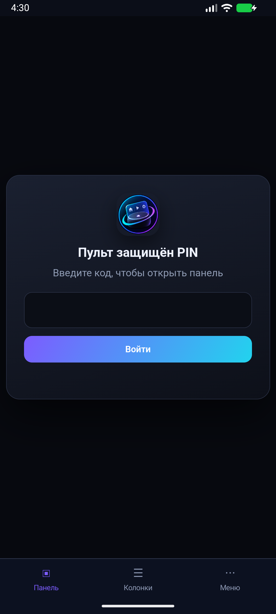
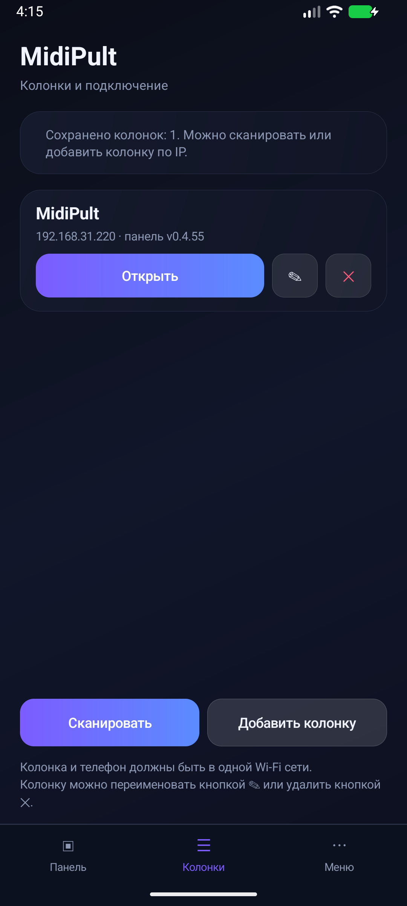
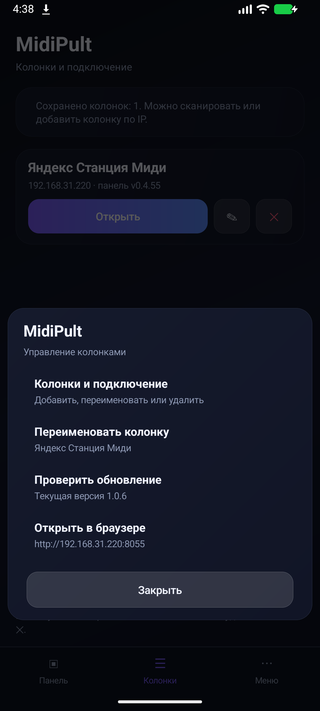
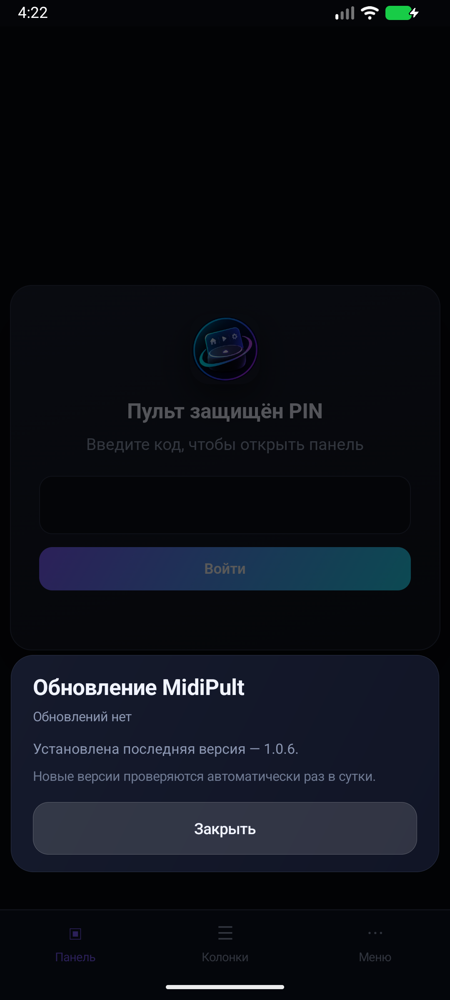
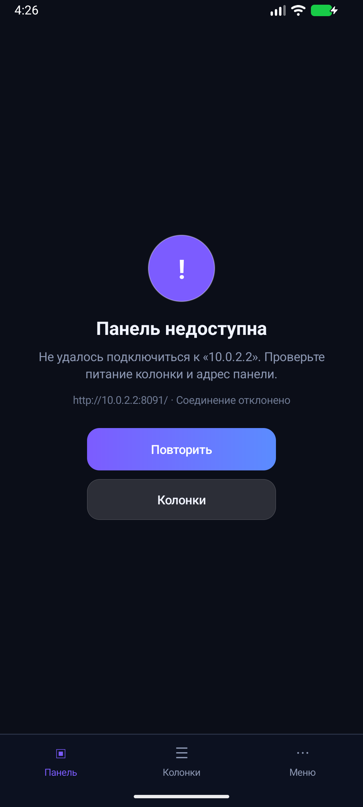

# MidiPult Android

<p align="center">
  
</p>

[](https://github.com/RoBiN19666/midipult-android/releases)
[](https://github.com/RoBiN19666/midipult-android/blob/main/LICENSE)
[](https://github.com/RoBiN19666/midipult-android)

**Пульт для Яндекс Станции Миди — в кармане.**

[Скачать APK](https://github.com/RoBiN19666/midipult-android/releases/latest)

Тонкая Android-оболочка вокруг веб-панели **[MidiPult](https://github.com/RoBiN19666/midipult)**.
Приложение не содержит интерфейс панели: оно находит колонку в локальной сети
и открывает её WebView. Поэтому изменения панели **не требуют пересборки APK**.

## Возможности

- автоматический поиск колонок по UDP (порт `8056`) и ручное добавление по адресу;
- несколько колонок: выбор, переименование, удаление, переключение;
- нижнее меню на всех экранах: **Панель · Колонки · Меню**;
- обновление панели «потянуть вниз» и кнопка повтора при ошибке;
- вместо пустого экрана — понятная заглушка: колонка не найдена / не ответила /
  панель вернула ошибку, с кнопками «Повторить» и «Колонки»;
- вход в панель по PIN, cookies и сессия сохраняются в WebView;
- скачивание бэкапов с именем файла из ответа панели и выбор файлов
  (с учётом типов, которые запрашивает страница);
- проверка и установка обновлений APK из GitHub Releases: прогресс, отмена
  загрузки, обязательная проверка SHA-256 и удаление старых APK;
- обновления панели и приложения — независимые каналы.

## Скриншоты

| Панель | Колонки |
|---|---|
|  |  |

| Меню | Обновление | Ошибка |
|---|---|---|
|  |  |  |

## Требования

- **Android 6.0 (API 23)**;
- телефон и колонка в одной Wi-Fi / LAN-сети;
- на колонке установлена и запущена панель **MidiPult** на порту **8055**;
- UDP-порт **8056** не заблокирован роутером (иначе — добавление по адресу).

## Как подключить

1. Установите APK.
2. Подключите телефон и колонку к одной Wi-Fi сети.
3. Откройте приложение: сохранённые колонки появятся списком.
4. Нажмите **«Сканировать»** — найденные колонки добавятся в список.
5. Выберите колонку кнопкой **«Открыть»**. Если поиск не работает, нажмите
   **«Добавить колонку»** и введите адрес панели, например `192.168.1.10:8055`.
6. Переименовать или удалить колонку можно кнопками ✎ и ✕ в её карточке.

## Обновления

APK проверяет релизы репозитория `midipult-android` не чаще раза в сутки.
Предлагаются только стабильные релизы (prerelease и draft пропускаются), у
которых есть файл `midipult-android-<версия>.apk` **и** `.apk.sha256`.
Проверка SHA-256 обязательна: без неё обновление не устанавливается. Загрузку
можно отменить, старые APK удаляются перед скачиванием новой версии.
Тихая установка без подтверждения пользователя в Android запрещена.

Панель обновляется отдельно, из своего репозитория, и APK при этом не
пересобирается.

## Сборка

Нужны JDK 17 и Android SDK 35 (platform + build-tools 35.0.0):

```bash
gradle assembleDebug
# или подписанный release, если заданы переменные окружения:
# ANDROID_KEYSTORE_PATH, ANDROID_KEYSTORE_PASSWORD, ANDROID_KEY_ALIAS, ANDROID_KEY_PASSWORD
gradle assembleRelease
```

`versionCode` и `versionName` задаются в `version.properties`.
Репозиторий не содержит Gradle wrapper: используется установленный Gradle
(в CI — 8.11.1).

## CI и релизы

Workflow `.github/workflows/android.yml` запускается по тегу `android-v*` или
вручную (`workflow_dispatch`).

- тег обязан совпадать с `versionName` из `version.properties`;
- `versionName` должен быть больше последнего релиза, `versionCode` — целым
  положительным числом; после сборки версия APK сверяется через `aapt2`;
- для релиза нужны секреты репозитория:
  `ANDROID_KEYSTORE_BASE64`, `ANDROID_KEYSTORE_PASSWORD`,
  `ANDROID_KEY_ALIAS`, `ANDROID_KEY_PASSWORD`;
- без секретов ручной запуск собирает debug APK с суффиксом `-debug`;
- к релизу прикладываются `midipult-android-<версия>.apk` и `.apk.sha256`.

Релиз: обновите `version.properties`, закоммитьте изменения, поставьте тег
`android-vX.Y.Z` и отправьте его в GitHub — workflow соберёт и опубликует APK.

## Ограничения

- **Только Android** — версий для iOS и десктопа нет и не планируется.
- **Тихая установка APK невозможна**: Android требует подтверждения пользователя.
- **WebView зависит от панели**: интерфейс приходит с колонки; если она
  недоступна, приложение показывает свою заглушку с повтором.
- **HTTP без TLS**: панель работает по локальной сети на `http://`, HTTPS
  намеренно не используется (см. README панели).
- **Нет фоновой работы и push-уведомлений** — приложение активно только когда
  открыто.
- **Голосовые команды** выполняются Алисой на колонке, не на телефоне.

## Ссылки

- [Репозиторий панели](https://github.com/RoBiN19666/midipult)
- [Все релизы APK](https://github.com/RoBiN19666/midipult-android/releases)
- [Issues](https://github.com/RoBiN19666/midipult-android/issues) — баги и предложения

## Лицензия

MIT. См. [LICENSE](LICENSE).
