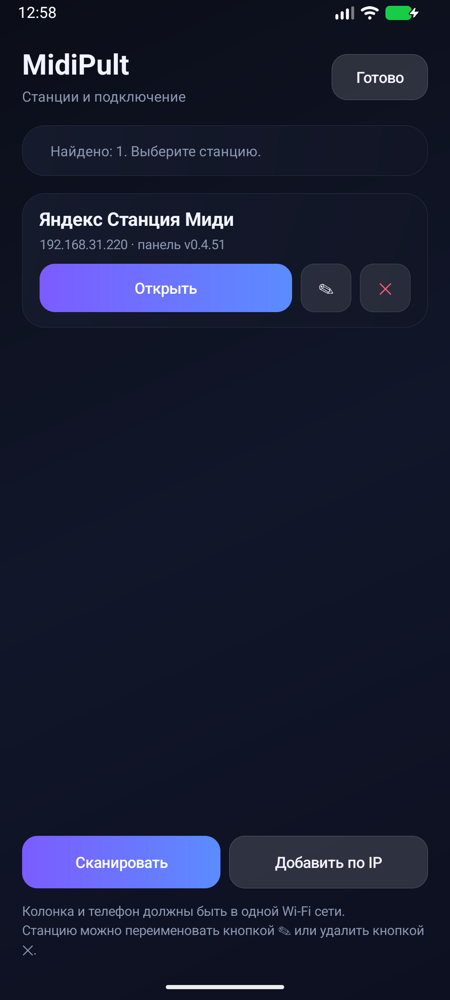
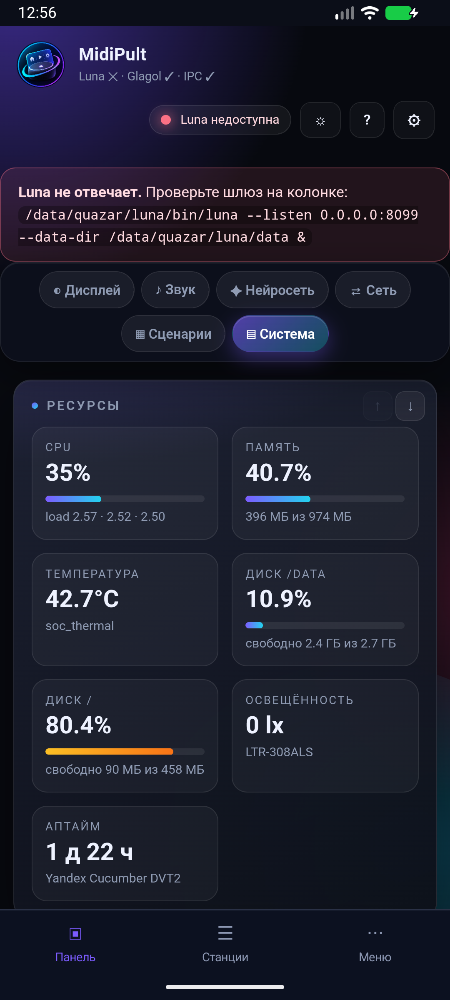

# MidiPult Android

  

**Пульт для Яндекс Станции Миди — в кармане.**

[Скачать APK](https://github.com/RoBiN19666/midipult-android/releases/latest)

Тонкая Android-оболочка вокруг веб-панели **[MidiPult](https://github.com/RoBiN19666/midipult)**. Приложение не содержит
интерфейс панели: оно находит станцию в локальной сети и открывает её WebView.
Поэтому изменения панели **не требуют пересборки APK**.

## О создании проекта

Приложение написано в паре с LLM-агентом (**DeepSeek Harness**) — тем же, что
и сама панель. Постановка задач, тесты на живых устройствах и финальная
проверка — за автором.

## Возможности

- автоматический поиск станций по UDP (порт `8056`);
- несколько станций, переключение, переименование и удаление;
- первый запуск сам находит колонку; если она одна — открывает сразу;
- ручной ввод IP, если discovery блокирует роутер;
- PIN, cookies и сессия панели;
- скачивание бэкапов и выбор файлов;
- проверка и установка обновлений APK из GitHub Releases;
- отдельные каналы обновлений приложения и панели.

## Скриншоты

| Настройка | Панель |
|---|---|
|  |  |

## Требования

- **Android 6.0 (API 23)**;
- телефон и колонка в одной Wi-Fi / LAN-сети;
- на колонке установлена и запущена панель **MidiPult** на порту **8055** —
  без неё приложение покажет пустой WebView;
- UDP-порт **8056** не заблокирован роутером (иначе — ручной ввод IP).

## Как подключить

1. Установите APK.
2. Подключите телефон и колонку к одной Wi-Fi сети.
3. Откройте приложение — оно найдёт станции автоматически.
4. Если станций несколько, выберите нужную.
5. Если поиск не работает, нажмите **«IP вручную»** и введите адрес панели.

## Обновления

APK проверяет релизы репозитория `midipult-android` не чаще раза в сутки,
скачивает файл `midipult-android-<версия>.apk`, проверяет SHA-256 и открывает
системный установщик. Тихая установка без подтверждения пользователя в
Android запрещена.

Панель обновляется отдельно, из своего репозитория, и APK при этом не
пересобирается.

## Ограничения

- **Только Android** — версий для iOS и десктопа нет и не планируется.
- **Тихая установка APK невозможна**: Android требует подтверждения пользователя.
- **WebView зависит от панели**: если колонка недоступна или панель не
  запущена, экран будет пустым — интерфейса внутри APK нет.
- **HTTP без TLS**: панель работает по локальной сети на `http://`, HTTPS
  намеренно не используется (см. README панели).
- **Нет фоновой работы и push-уведомлений** — приложение активно только когда
  открыто.
- **Голосовые команды** выполняются Алисой на колонке, не на телефоне.

## Ссылки

- [Репозиторий панели](https://github.com/RoBiN19666/midipult)
- [Все релизы APK](https://github.com/RoBiN19666/midipult-android/releases)
- [Issues](https://github.com/RoBiN19666/midipult-android/issues) — баги и предложения

## Лицензия

MIT. См. [LICENSE](LICENSE).
